<div align="center">

<a href="https://vellium.dev" target="_blank" rel="noopener noreferrer">
  
</a>

<br /><br />

#  Tactile - Satisfying Mechanical Keyboard Sounds for Windows

</div>

---

<div align="center">

[](#english-version)
&nbsp;&nbsp;&nbsp;&nbsp;
[](#turkish-version)

</div>

---

<div align="center">

[](https://github.com/emirtdede/tactile/actions/workflows/ci.yml)


</div>

---

<a id="english-version"></a>

##  Overview

**Tactile (`v1.0.0`)** turns your keyboard into a premium mechanical experience. It plays high-fidelity switch sounds while you type - press and release, per key, per profile - and gets out of the way otherwise. It is **local-first**: no account, no telemetry, no backend service.

Built with **Electron 30**, **Node.js** and **vanilla JavaScript**. A sandboxed renderer talks to a hardened main process over a validated IPC bridge; a local **SQLite** database (`sql.js`) holds your profiles and settings, and a native global hook feeds real key events with sub-frame latency.

Tactile ships with **18 bundled sound packs** (Cherry MX Blue, Brown, Red and Black in ABS and PBT, Topre Purple, NovelKeys Cream, Holy Pandas, EG Crystal, EG Oreo and travel variants), **73 complete languages**, a **4-step onboarding**, **system / light / dark / custom themes** with theme-matched app icons, and a **serverless cloud backup** that writes one atomic snapshot into the OneDrive, Google Drive or Dropbox folder you already have - for free, with no server of ours involved.

> **Documentation:** architecture, localization, sync, updates, testing and the release runbook are indexed in [`docs/README.md`](docs/README.md).

---

##  Interface Tour

<div align="center">

| Sounds | Import | Settings |
| :---: | :---: | :---: |
| 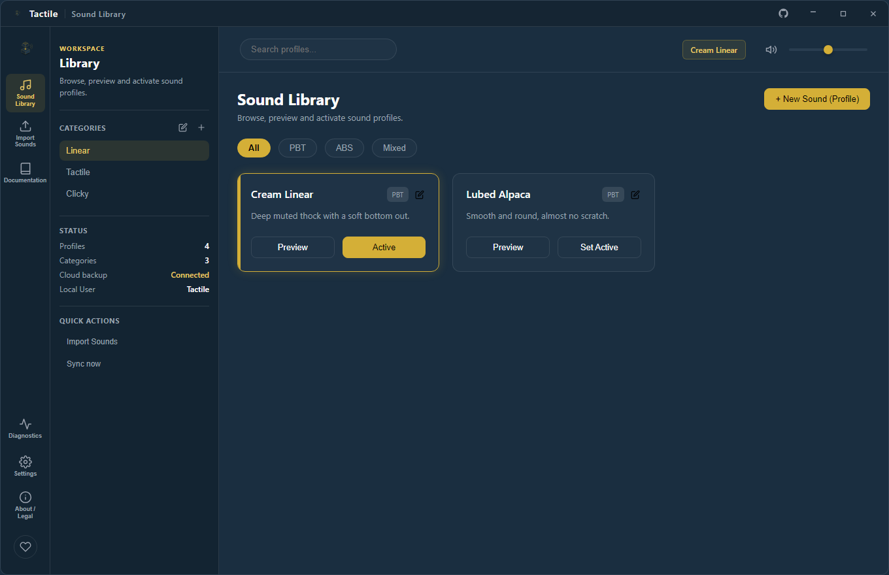 | 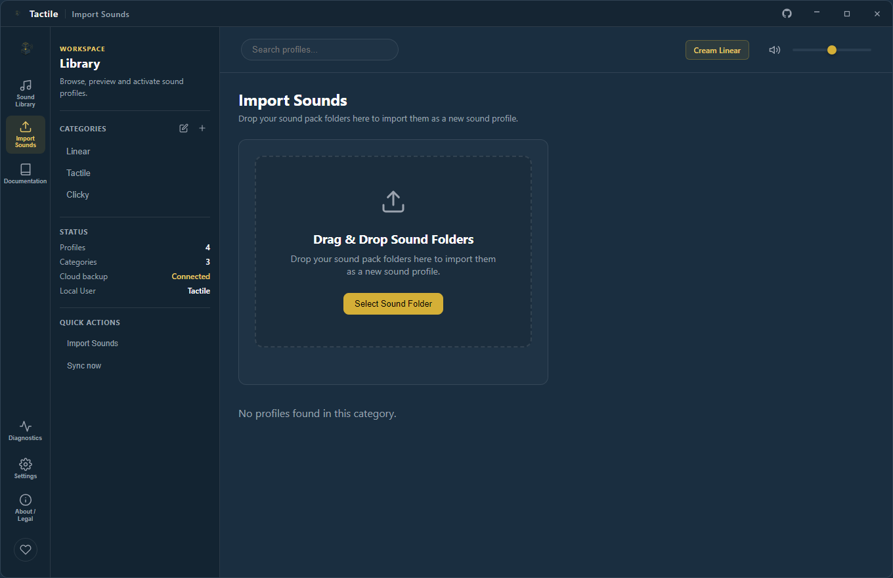 | 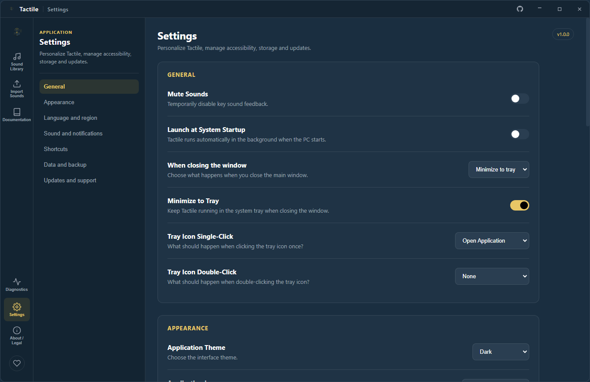 |

| Cloud backup | Documentation | Diagnostics |
| :---: | :---: | :---: |
| 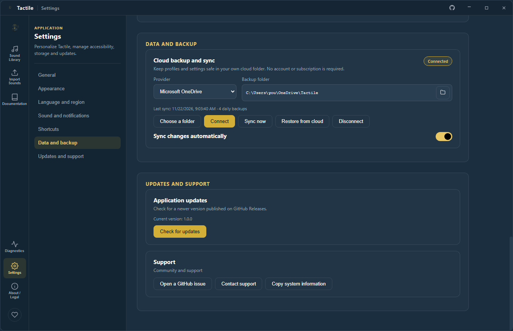 | 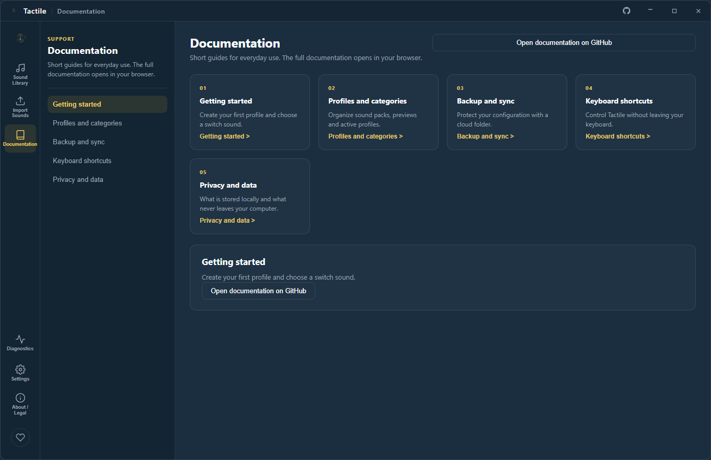 | 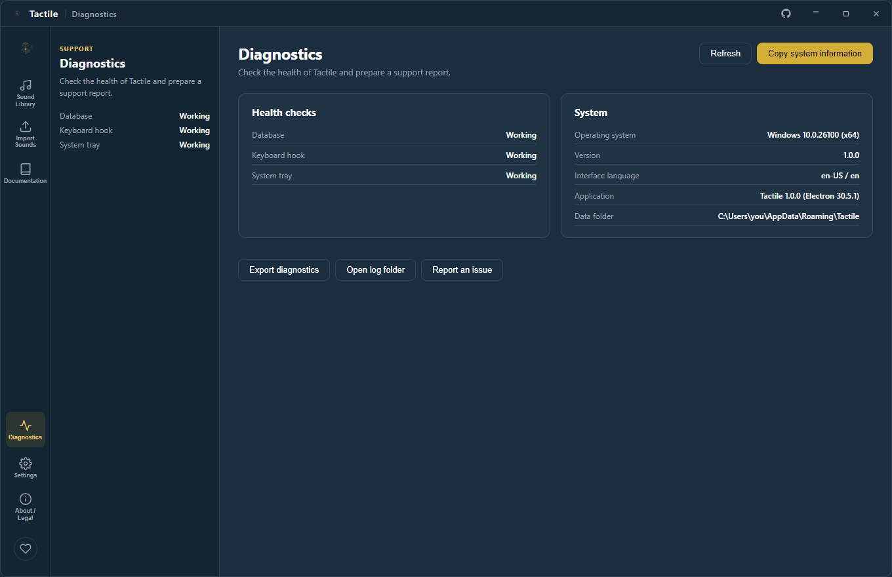 |

| About and legal | Onboarding: language | Onboarding: theme |
| :---: | :---: | :---: |
| 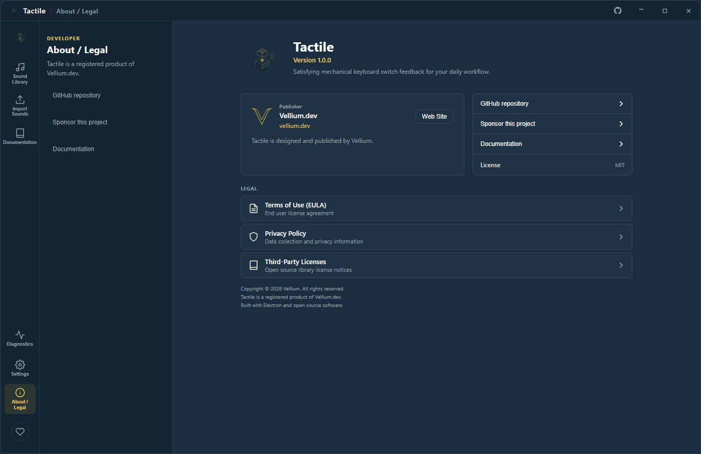 | 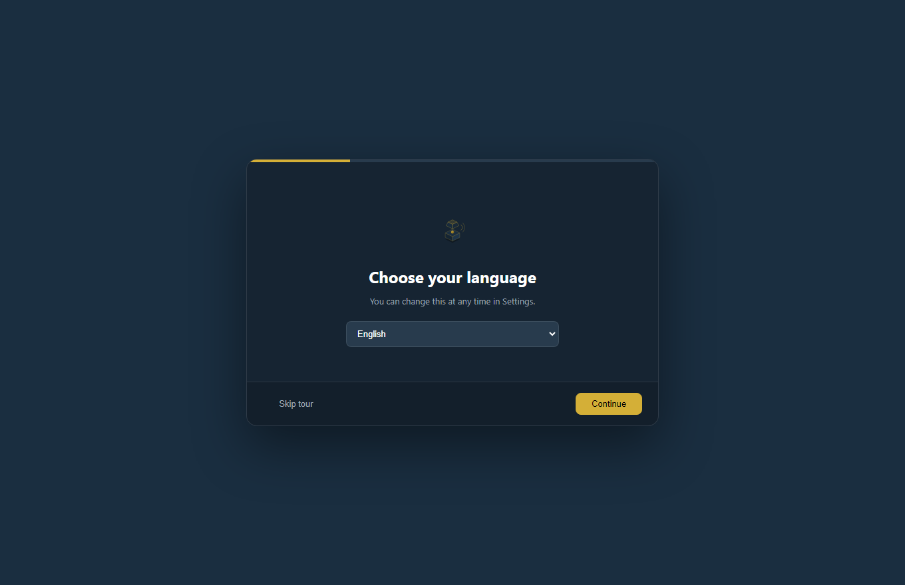 | 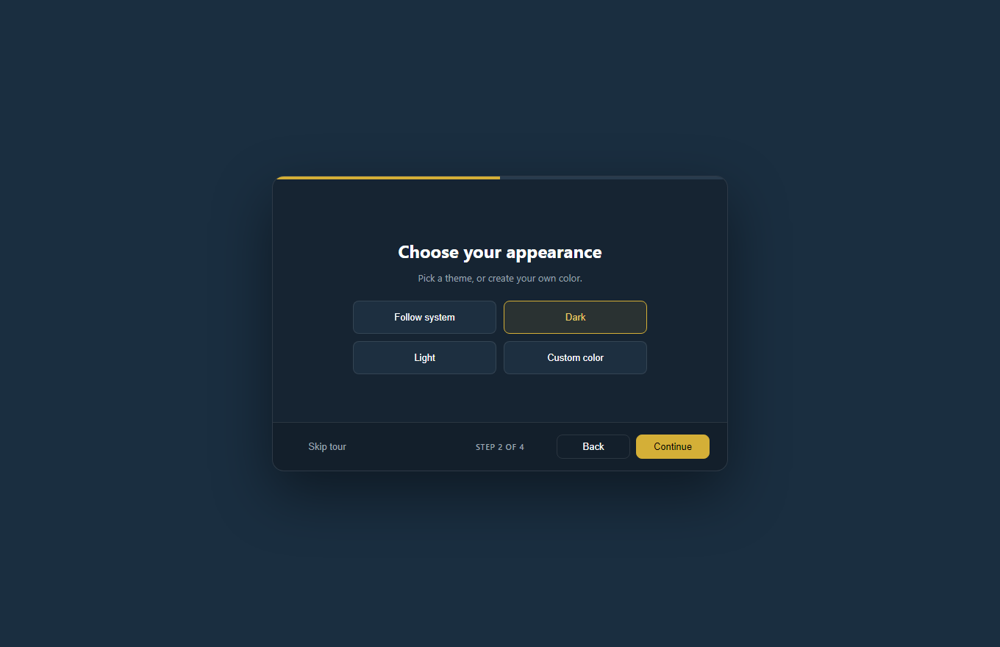 |

| Onboarding: welcome | Onboarding: tour | Light theme |
| :---: | :---: | :---: |
| 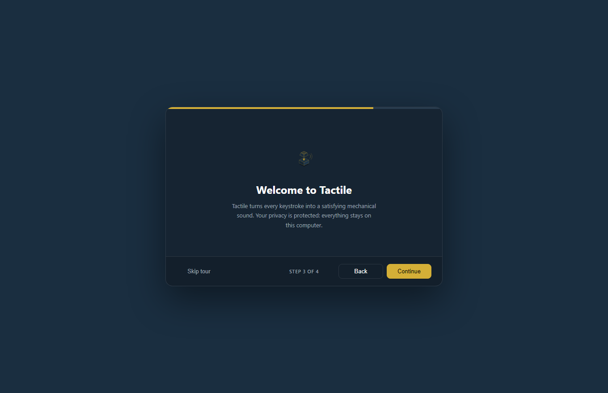 | 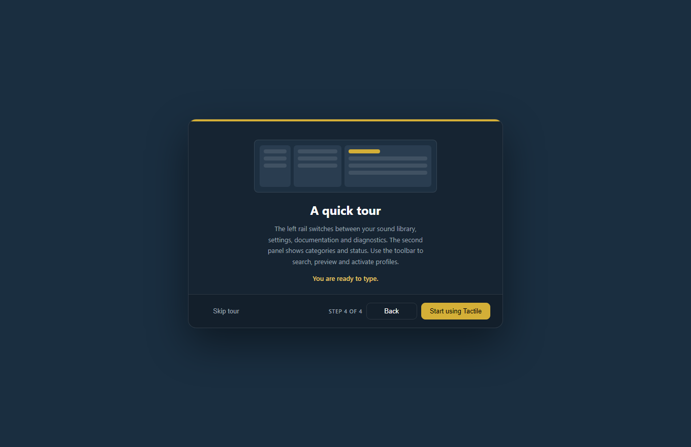 | 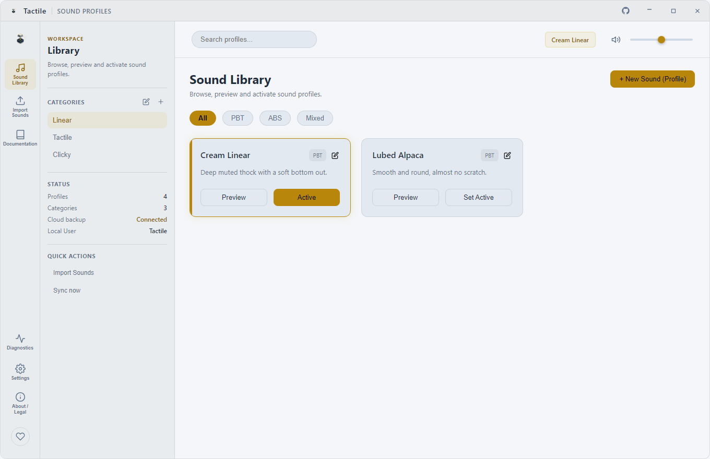 |

</div>

---

##  Key Features

###  Sound engine and library
- 18 bundled packs with press and release variants, per-key overrides and per-profile volume.
- Profiles grouped in categories, one click to activate; the active profile is shown in the rail footer.
- Import from a folder or a mixed zip; format detection for `config.json` packs and flat per-key folders.
- Audio is resolved inside the pack root only - traversal and absolute paths are rejected - and cached as Base64 data URIs keyed by path and mtime.

###  Two-level interface
- Slim icon rail plus a contextual sub-navigation panel, both fully theme-aware.
- Views: Sounds, Import, Settings, Docs, Diagnostics, About and Legal.
- Settings split into seven sections (General, Appearance, Language, Sound, Shortcuts, Data, Updates) with a sticky section list and scroll spy.
- Frameless window, custom title bar, responsive down to 800x500.

###  Themes, icons and accessibility
- **System / Light / Dark / Custom** themes. Custom accepts any hex colour and mixes surfaces, borders and accents from it.
- **Theme / Light / Dark / Custom** app icons applied to the window, taskbar, tray and desktop shortcut.
- Zoom 80-150 percent, high contrast and reduce motion.
- Focus rings on every control, translated `aria-label` on icon-only buttons, dialogs announced as dialogs and closed with Escape.

###  73 languages and 4-step onboarding
- **73 complete languages**, each with the full key set, enforced by tests. Right-to-left layouts for Arabic, Hebrew, Persian and Urdu.
- The OS display language is preselected on first run; English is the fallback.
- The setup wizard asks for the language **before anything is installed** and hands the choice to the app.
- Onboarding is four separate screens in strict order: **language, theme, welcome, tour**. Never combined.

###  Free cloud backup without a server
- One atomic JSON snapshot into `OneDrive/`, `Google Drive/`, `Dropbox/` or any folder, under a `Tactile/` subfolder.
- Previous snapshot plus **15 daily backups**; recovery chain `sync -> previous -> newest backup`.
- Empty local data can never overwrite a non-empty backup.
- 400 ms debounce, flush on quit, and a "Restore" / "Start fresh" prompt when the cloud copy is newer.
- Connect, Sync now, Restore, Open folder, Disconnect and an auto-sync switch - all translated.

###  Platform integration
- Close behaviour: **ask, minimize to tray, or quit**.
- Start with Windows, silently into the tray.
- Global mute hotkey (`Control+K`) and quick-task hotkey (`Control+Alt+N`), both user-editable with a live recorder.
- Taskbar Jump List: Sounds, Import, Settings, Docs.
- Tray menu (Open, Settings, Docs, Mute, Quit) in the active language, and notifications with sound feedback.

###  Updates and diagnostics
- **electron-updater** with delta packages and SHA-512 verification; Store builds report "managed by the Store".
- Diagnostics page with versions, locale, theme, database size, cloud status and log path; copy, export, open log folder and a one-click GitHub issue report.
- About page with version, MIT licence, publisher card (Vellium.dev), website, GitHub, sponsor links and legal notices.

---

##  Tech Stack

<div align="center">


</div>

| Layer | Choice | Why |
| :--- | :--- | :--- |
| Shell | Electron 30 | Native tray, jump list, global shortcuts, auto-update |
| Renderer | Vanilla JS + CSS tokens | No bundler, instant startup, one stylesheet per concern |
| Storage | `sql.js` (SQLite) | Real SQL with a single portable file, no native module |
| Key capture | `uiohook-napi` | Global hook outside the window, low latency |
| Audio | Howler + data URIs | Cross-platform playback with a bounded LRU cache |
| Updates | `electron-updater` | GitHub releases, block-map deltas, SHA-512 |
| Tests | `node:test` | Zero-dependency suite that runs anywhere Node runs |

---

##  Architecture

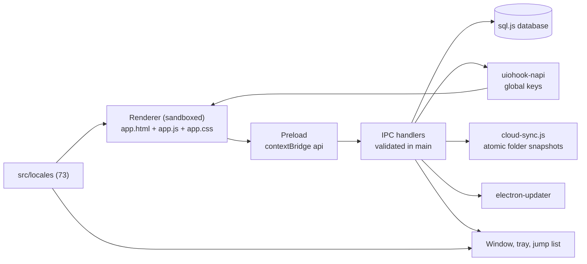

**Security model.** The renderer runs with `sandbox: true`, `contextIsolation: true` and `nodeIntegration: false` behind a strict Content-Security-Policy. It receives no Node primitive; `window.api` in `src/preload.js` is the whole privileged surface. Every IPC payload is validated in the main process, every setting write passes a whitelist (`SETTING_NORMALIZERS`), popups and navigation are denied, and all external links go through `shell.openExternal` after a scheme check. Audio reads are confined to the selected pack root. Cloud snapshots are validated before they can replace a working database.

---

##  Storage and Data Boundaries

| Path / Boundary | Protection | Contents |
| :--- | :--- | :--- |
| `%APPDATA%\Tactile\tactile.sqlite` | Single-file SQLite via `sql.js`, parameterized SQL | Categories, profiles, settings |
| `%APPDATA%\Tactile\logs\` | Local only, redacted diagnostics | Runtime logs |
| `<provider>\Tactile\tactile-sync.json` | Atomic write, validated on read | Newest cloud snapshot |
| `<provider>\Tactile\tactile-previous.json` | Written before replacement | One snapshot behind |
| `<provider>\Tactile\tactile-backup-YYYY-MM-DD.json` | 15-day rotation | Daily rollover |
| Renderer to main IPC | `contextIsolation`, `sandbox`, whitelisted handlers | Validated commands and events |
| Audio pack root | `resolveWithinPath`, extension allow-list | Sound files only |

---

##  Installation and Usage

### Installing as an end user

1. Download `Tactile-Setup-1.0.0.exe` from [GitHub Releases](https://github.com/emirtdede/tactile/releases).
2. Run it. **No administrator prompt** - it installs per-user (`perMachine: false`).
3. The first wizard page asks for your language: **73 options**, with your Windows display language preselected.
4. Choose the install directory (optional), finish, and launch **Tactile** from the Start menu.

**SmartScreen on unsigned downloads:** until release signing is applied, Windows may show "Windows protected your PC". Choose **More info -> Run anyway**. The Microsoft Store build is re-signed by Microsoft and never shows it.

**Uninstall:** Windows Settings -> Apps -> Tactile -> Uninstall. Your data under `%APPDATA%\Tactile` is kept by default so a reinstall keeps your profiles.

### First run

1. Onboarding asks for language, then theme, then greets you, then shows a short tour.
2. Pick a profile from the library and press **Activate**.
3. Type anywhere - sounds play through the global hook.
4. Open **Settings -> Data** to connect OneDrive, Google Drive or Dropbox for a free backup.

### Prerequisites (building from source)
- Windows 10 (1809+) or Windows 11 (64-bit), macOS 12+ or a modern Linux distribution
- **Node.js 20+** and npm
- **Git**

### Run from source

```bash
git clone https://github.com/emirtdede/tactile.git
cd tactile
npm install
npm start
```

### Tests and release gates

```bash
node --test tools/tests/            # 72 tests: a11y, security, i18n, modules, dashes
node tools/i18n-status.js           # 73 declared, 73 complete, 0 missing, 0 partial
node tools/i18n/placeholders.js     # issues: 0
node tools/gen-installer-languages.js
```

### Build installers

```bash
npm run build:icons                 # regenerate app, tray and installer icons
npm run build:win                   # dist/Tactile-Setup-1.0.0.exe + blockmap + latest.yml
npm run build:appx                  # Microsoft Store package
npm run build:mac                   # run on macOS
npm run build:linux                 # run on Linux
```

### Reproducing the screenshots

```bash
node node_modules/electron/cli.js tools/capture.js
```

Writes 12 PNGs to `docs/screenshots/` and must report `renderer errors: 0`.

---

##  Distribution Packages

Build artifacts land in `dist/`:

- **NSIS installer** - `Tactile-Setup-1.0.0.exe` (per-user, no UAC)
- **Delta block map** - `Tactile-Setup-1.0.0.exe.blockmap`
- **Update manifest** - `latest.yml`
- **AppX package** - via `--win appx` (Store identity `TactileApp`)
- **Unpacked build** - `dist/win-unpacked/`

Published builds and release notes: [GitHub Releases](https://github.com/emirtdede/tactile/releases).

---

##  License and Publisher

**MIT License.** Copyright (c) 2026 **Vellium**. See [`LICENSE`](LICENSE).

- **Publisher:** Vellium.dev - [vellium.dev](https://vellium.dev)
- **Project page:** [github.com/emirtdede/tactile](https://github.com/emirtdede/tactile)
- **Support:** [support@vellium.dev](mailto:support@vellium.dev)
- **Security disclosure:** [security@vellium.dev](mailto:security@vellium.dev)
- **Sponsor:** [github.com/sponsors/emirtdede](https://github.com/sponsors/emirtdede)
- **Documentation:** [`docs/README.md`](docs/README.md)
- **Changelog:** [`docs/CHANGELOG.md`](docs/CHANGELOG.md)

---

<br>

---

<a id="turkish-version"></a>
# Türkçe Versiyon

<div align="center">
  
  <h3>Tactile - Windows için Tatmin Edici Mekanik Klavye Sesleri</h3>
  <p><em>Profil bazlı ses paketleri, 73 dil, sistem / açık / koyu / özel tema, ücretsiz bulut yedeği ve 4 adımlı kurulum</em></p>
  <p><strong>Geliştirici ve Yayıncı: <a href="https://vellium.dev">Vellium.dev</a></strong></p>
</div>

<br>

##  Proje Genel Bakış

**Tactile (`v1.0.0`)**, yazarken yüksek kaliteli mekanik switch sesleri çalan, yerel öncelikli bir Windows masaüstü uygulamasıdır. **Electron 30**, **Node.js** ve **vanilla JavaScript** ile geliştirilmiştir. Sandbox içindeki arayüz, doğrulanmış bir IPC köprüsü üzerinden ana süreçle konuşur; profiller ve ayarlar yerel bir **SQLite** (`sql.js`) veritabanında tutulur. Hesap, bulut servisi veya internet bağlantısı gerektirmez.

Uygulama **18 ses paketi** (Cherry MX Blue, Brown, Red, Black - ABS ve PBT; Topre Purple, NovelKeys Cream, Holy Pandas, EG Crystal, EG Oreo ve travel varyantları), **73 tam dil**, **4 adımlı ilk kurulum**, **sistem / açık / koyu / özel tema**, temaya uygun uygulama ikonları ve **sunucusuz bulut yedeği** ile gelir. Yedek, zaten sahip olduğunuz OneDrive, Google Drive veya Dropbox klasörüne tek bir atomik dosya olarak yazılır - bizim sunucumuz yok, ücret yok.

> **Dokümantasyon:** mimari, yerelleştirme, senkronizasyon, güncellemeler, testler ve sürüm runbook'u [`docs/README.md`](docs/README.md) içinde indekslenmiştir.

---

##  Öne Çıkan Özellikler

###  Ses motoru ve kütüphane
- 18 hazır paket; basılma ve bırakılma sesleri, tuş bazlı özel atamalar, profil bazlı ses seviyesi.
- Profiller kategorilere ayrılır, tek tıkla etkinleşir; etkin profil kenar çubuğunda görünür.
- Klasörden veya karışık zip dosyasından içe aktarma; `config.json` ve tuş bazlı klasör biçimlerini otomatik tanıma.
- Ses dosyaları yalnızca paket klasörü içinden okunur; dizin aşımı ve mutlak yollar reddedilir.

###  İki katmanlı arayüz
- İnce ikon rayı ve bağlama duyarlı alt gezinme paneli; ikisi de temaya uyumlu.
- Ekranlar: Sesler, İçe Aktar, Ayarlar, Dokümantasyon, Tanılama, Hakkında ve Yasal.
- Ayarlar yedi bölüm: Genel, Görünüm, Dil, Ses, Kısayollar, Veri, Güncellemeler.
- Çerçevesiz pencere, özel başlık çubuğu, 800x500'e kadar duyarlı yerleşim.

###  Temalar, ikonlar ve erişilebilirlik
- **Sistem / Açık / Koyu / Özel** tema. Özel tema herhangi bir hex rengi kabul eder; yüzeyler, kenarlıklar ve vurgular bu renkten türetilir.
- **Tema / Açık / Koyu / Özel** uygulama ikonu; pencere, görev çubuğu, sistem tepsisi ve masaüstü kısayolunda güncellenir.
- Yakınlaştırma yüzde 80-150, yüksek kontrast ve hareketi azaltma.
- Her kontrolde odak halkası, ikon düğmelerde çevrilmiş `aria-label`, Escape ile kapanan diyaloglar.

###  73 dil ve 4 adımlı ilk kurulum
- **73 tam dil**; her biri aynı anahtar kümesine sahip ve testlerle zorunlu.
- İlk açılışta işletim sistemi dili seçili gelir; bilinmeyen dilde İngilizce'ye düşer.
- Kurulum sihirbazı **her şeyden önce** dil sorar ve seçimi uygulamaya devreder.
- İlk kurulum dört ayrı ekran: **dil, tema, karşılama, tur**. Asla tek ekranda birleştirilmez.

###  Sunucusuz ücretsiz bulut yedeği
- OneDrive, Google Drive, Dropbox veya herhangi bir klasöre `Tactile/` alt klasörü içinde atomik JSON yedek.
- Önceki yedek ve **15 günlük** günlük yedekler; kurtarma zinciri `sync -> previous -> en yeni yedek`.
- Boş yerel veri, dolu bir bulut yedeğinin üzerine asla yazılmaz.
- 400 ms gecikmeli otomatik yedek, çıkışta zorunlu kayıt; bulut dosyası daha yeniyse "Geri yükle" / "Sıfırdan başla" sorusu.
- Bağlan, Şimdi eşitle, Geri yükle, Klasörü aç, Bağlantıyı kes ve otomatik eşitleme anahtarı - hepsi çevrilmiş.

###  Platform entegrasyonu
- Kapatma davranışı: **sor, sistem tepsisine küçült veya çıkış**.
- Windows ile birlikte başlat, sessizce sistem tepsisinde.
- Genel sessize alma kısayolu (`Control+K`) ve hızlı görev kısayolu (`Control+Alt+N`); ikisi de canlı kaydedici ile değiştirilebilir.
- Görev çubuğu Atla Listesi: Sesler, İçe Aktar, Ayarlar, Dokümantasyon.
- Sistem tepsisi menüsü (Aç, Ayarlar, Dokümantasyon, Sessiz, Çıkış) etkin dilde; sesli bildirim geri bildirimi.

###  Güncelleme ve tanılama
- **electron-updater** ile delta paketler ve SHA-512 doğrulaması; Store sürümleri "Store tarafından yönetiliyor" olarak görünür.
- Tanılama sayfası: sürümler, dil, tema, veritabanı boyutu, bulut durumu, günlük yolu; kopyala, dışa aktar, günlük klasörünü aç ve tek tıkla GitHub bildirimi.
- Hakkında sayfası: sürüm, MIT lisansı, yayıncı kartı (Vellium.dev), web sitesi, GitHub, sponsor bağlantıları ve yasal metinler.

---

##  Kurulum ve Kullanım

### Son kullanıcı için
1. `Tactile-Setup-1.0.0.exe` dosyasını [GitHub Releases](https://github.com/emirtdede/tactile/releases) sayfasından indirin.
2. Çalıştırın. **Yönetici (UAC) izni istenmez** - kurulum kullanıcı hesabına yapılır.
3. İlk sihirbaz sayfası dil sorar: **73 seçenek**, Windows görüntüleme diliniz seçili.
4. Kurulum klasörünü seçin (isteğe bağlı), bitirin ve Başlat menüsünden **Tactile**'ı açın.

**İmzasız indirmede SmartScreen:** imzalama yapılana kadar Windows "Windows korumalı bilgisayarınızı korudu" uyarısı gösterebilir. **Ek bilgi -> Yine de çalıştır** seçin. Microsoft Store sürümü Microsoft tarafından yeniden imzalanır ve bu uyarıyı göstermez.

**Kaldırma:** Windows Ayarlar -> Uygulamalar -> Tactile -> Kaldır. `%APPDATA%\Tactile` altındaki verileriniz varsayılan olarak korunur.

### İlk kullanım
1. İlk kurulum dil, tema, karşılama ve tur adımlarını sırasıyla gösterir.
2. Kütüphaneden bir profil seçip **Etkinleştir**'e basın.
3. Herhangi bir yerde yazın - sesler genel kanca üzerinden çalar.
4. **Ayarlar -> Veri** bölümünden OneDrive, Google Drive veya Dropbox bağlayarak ücretsiz yedek alın.

### Kaynaktan çalıştırma

```bash
git clone https://github.com/emirtdede/tactile.git
cd tactile
npm install
npm start
```

### Testler ve sürüm kapıları

```bash
node --test tools/tests/
node tools/i18n-status.js
node tools/i18n/placeholders.js
```

### Kurulum dosyası derleme

```bash
npm run build:icons
npm run build:win
npx electron-builder --win appx --x64
```

---

##  Lisans ve Yayıncı

**MIT Lisansı.** Copyright (c) 2026 **Vellium**. Ayrıntılar için [`LICENSE`](LICENSE).

- **Yayıncı:** Vellium.dev - [vellium.dev](https://vellium.dev)
- **Proje sayfası:** [github.com/emirtdede/tactile](https://github.com/emirtdede/tactile)
- **Destek:** [support@vellium.dev](mailto:support@vellium.dev)
- **Güvenlik bildirimi:** [security@vellium.dev](mailto:security@vellium.dev)
- **Sponsor:** [github.com/sponsors/emirtdede](https://github.com/sponsors/emirtdede)
- **Dokümantasyon:** [`docs/README.md`](docs/README.md)
- **Değişiklik kaydı:** [`docs/CHANGELOG.md`](docs/CHANGELOG.md)
